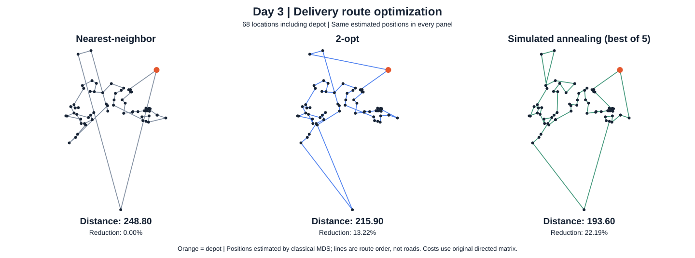

# Delivery Route Visualizations

This folder contains C++ visualization code and generated route comparisons using the actual Day 3 dataset of 68 locations.

## Algorithms Compared

- Nearest Neighbor
- 2-opt
- Simulated Annealing (best of five independent runs)

The visualization uses the team's original C++ algorithm functions and optimization parameters without external optimization libraries.

## Results

| Algorithm | Total Distance | Reduction |
|---|---:|---:|
| Nearest Neighbor | 248.8 | 0.00% |
| 2-opt | 215.9 | 13.22% |
| Simulated Annealing | 193.6 | 22.19% |

Simulated Annealing results may vary between executions due to randomization.

## Files

- `visualize.cpp` — C++ visualization source code.
- `Day3Routes.csv` — Generated delivery route sequences.
- `Day3RouteComparison.svg` — Generated route comparison.

## Visualization

Node positions are mathematically estimated from the actual distance matrix rather than geographic coordinates.
